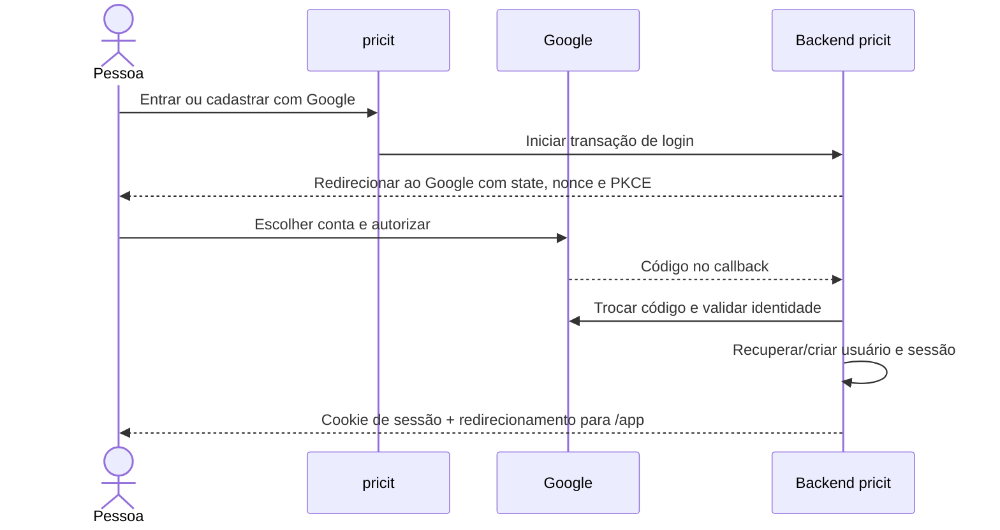

# Login com Google no pricit

As telas `/login` e `/cadastro` estão prontas. **OAuth ainda não está implementado. O isolamento por conta já está ativo.** O acesso por e-mail e senha já possui sessões revogáveis e proteção da API; as contas podem ser criadas pelo questionário de cadastro ou pelo administrador e possuem dados isolados (consulte o README). Configurar o Google Cloud, sozinho, não ativa os botões atuais. As duas telas deverão usar o mesmo fluxo: um novo `sub` do Google cria uma conta; um `sub` existente abre a conta correspondente.

## 1. Configurar o Google

1. Abra https://console.cloud.google.com/ e selecione ou crie o projeto do pricit.
2. Na **Google Auth Platform**, configure **Branding** (nome pricit, contato de suporte e domínio), **Audience** (externo, se aberto ao público) e **Data Access**. Use apenas `openid`, `email` e `profile`.
3. Enquanto estiver em teste, adicione suas contas em **Test users**.
4. Em **Clients**, crie um cliente OAuth do tipo **Web application**.
5. Para o fluxo de servidor proposto, registre exatamente este **Authorized redirect URI**:

   `http://localhost:3000/api/v1/auth/google/callback`

   Essa rota é o contrato proposto para a implementação; ela ainda não existe. A porta 3000 encaminha `/api/*` ao backend pelo Next.js. Evite misturar `localhost` e `127.0.0.1`.
6. Em produção, adicione `https://SEU-DOMINIO/api/v1/auth/google/callback`. Domínios, política de privacidade e termos devem refletir o serviço real. Siga o processo de publicação/verificação solicitado pelo Google.
7. Guarde o **Client ID** e o **Client Secret** no gerenciador de segredos do servidor. Não envie o segredo pelo chat nem o coloque em `NEXT_PUBLIC_*`, Git, imagens Docker ou JavaScript entregue ao navegador.

Origens JavaScript autorizadas não são necessárias para este fluxo com redirecionamento iniciado no servidor. Se futuramente houver integração via Google Identity Services no navegador, configure também a origem exata, como `http://localhost:3000`.

## 2. Implementação que falta no projeto

Use uma biblioteca OIDC mantida, com descoberta em `https://accounts.google.com/.well-known/openid-configuration`, em vez de validar tokens manualmente.

- `GET /api/v1/auth/google/start`: gerar `state`, `nonce` e PKCE; guardar a transação por poucos minutos no servidor e redirecionar ao Google.
- `GET /api/v1/auth/google/callback`: verificar `state` de uso único, trocar o código usando o segredo do servidor, validar assinatura/JWKS, emissor, audiência, validade e `nonce`. Usar o `sub` como identidade; não usar o e-mail como chave de conta.
- Criar ou recuperar o usuário. Persistir nome/e-mail criptografados usando a camada de campos criptografados; nunca gravar tokens ou credenciais nos logs. Não guardar tokens de acesso/refresh se não houver necessidade de acessar APIs do Google.
- Criar uma sessão opaca e revogável no servidor; cookie `HttpOnly`, `SameSite=Lax`, `Secure` em HTTPS, expiração e renovação controladas. Não guardar o ID token no localStorage. Logout invalida a sessão no servidor.
- Trocar o aviso atual dos botões por navegação para `/api/v1/auth/google/start`.
- Reutilizar a proteção já implementada em todas as rotas da API, PDFs e `/app`: `owner_id` em ingredientes, receitas e simulações e validação de propriedade dos vínculos. Preservar os testes que impedem uma conta de ler ou modificar os dados de outra.
- Definir explicitamente o proprietário dos registros locais já existentes; nunca distribuí-los automaticamente a qualquer novo usuário.
- Proteger operações de escrita contra CSRF, restringir CORS, limitar tentativas e usar HTTPS na hospedagem.

## 3. O caminho de uma entrada

## Referências oficiais

- [OpenID Connect do Google](https://developers.google.com/identity/openid-connect/openid-connect)
- [OAuth para aplicações Web no servidor](https://developers.google.com/identity/protocols/oauth2/web-server)
- [Políticas OAuth](https://developers.google.com/identity/protocols/oauth2/policies)
